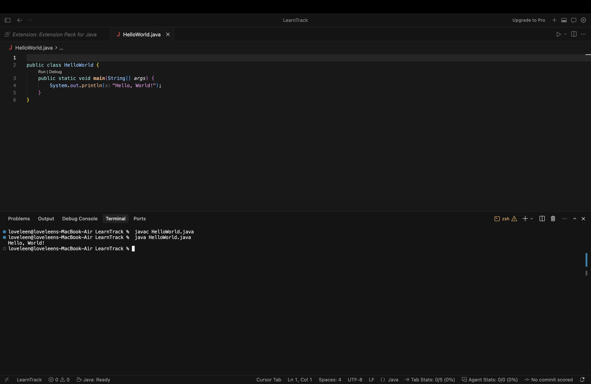

# Setup Instructions

## JDK version used

`javac 21.0.12` (JDK 21)

Check yours with:

```
java -version
javac -version
```

## Hello World

Create `HelloWorld.java`:

```java
public class HelloWorld {
    public static void main(String[] args) {
        System.out.println("Hello, World!");
    }
}
```

Compile and run:

```
javac HelloWorld.java    # produces HelloWorld.class (bytecode)
java HelloWorld          # prints: Hello, World!
```



`javac` turns the source into bytecode, and `java` starts the JVM, which runs that bytecode and prints the message.

